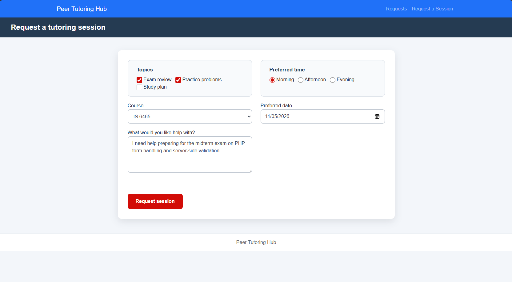
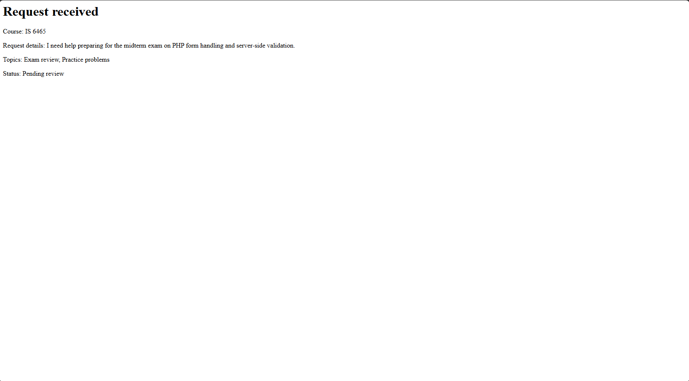
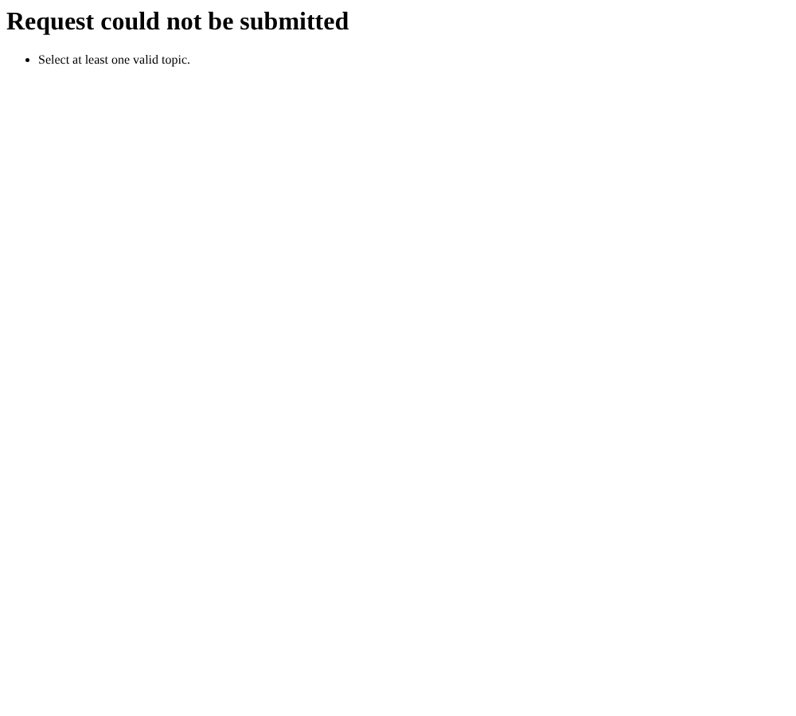
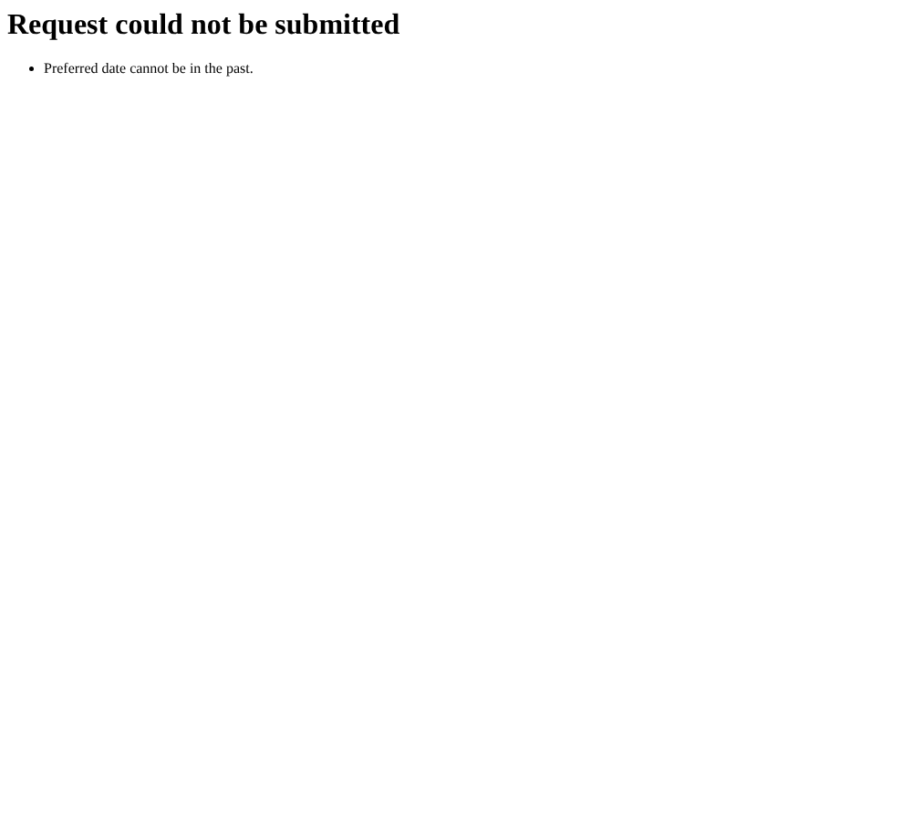
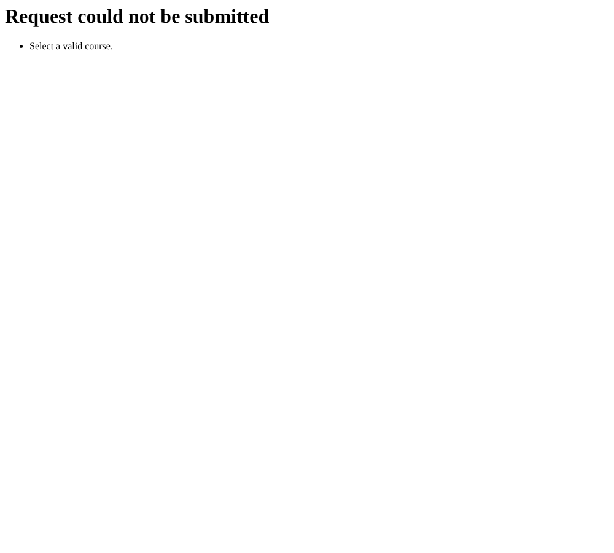
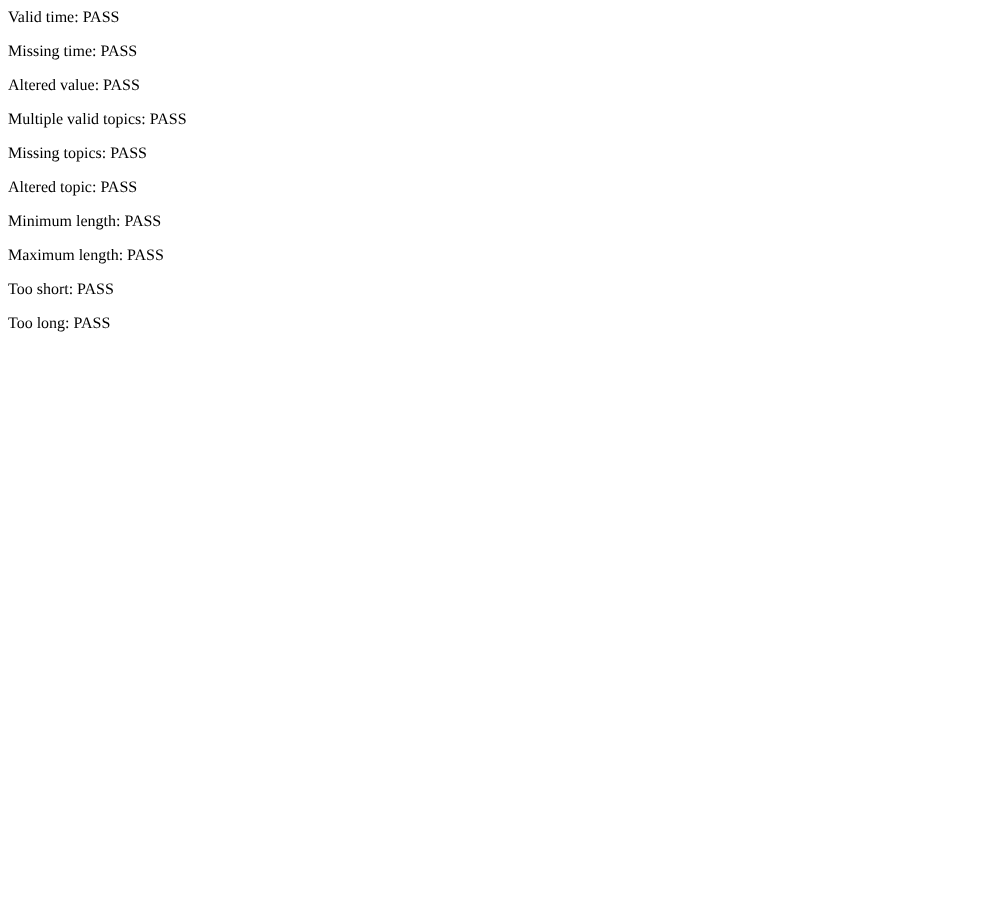
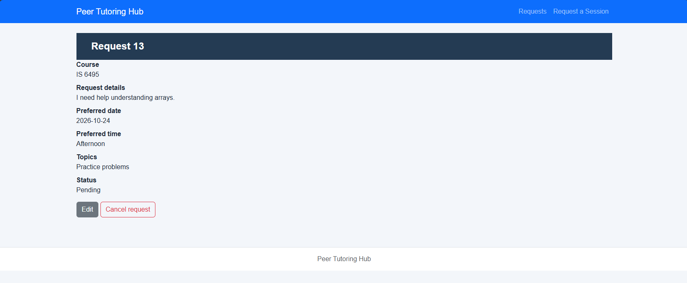

# Lab 4: Templates, Form Controls and CRUD

**Course:** IS 6465-090 Web Based Applications
**Project:** Peer Tutoring Hub (`lab4-starter`)
**Date completed:** October 30, 2026

---

## Part 1: Run the application

I opened the project, started the PHP server, and visited `request-form.php`. I filled out one valid tutoring request with these values:

| Field | Value |
| --- | --- |
| Course | IS 6465 |
| Preferred date | 2026-11-05 (a future date) |
| What would you like help with? | "I need help preparing for the midterm exam on PHP form handling and server-side validation." |
| Topics | Exam review, Practice problems |
| Preferred time | Morning |

### What happens after submitting

When I click **Request session**, the browser first runs its own client-side checks because the `course`, `preferreddate`, `reason`, and `preferredtime` controls carry the `required` attribute. Once those pass, the browser leaves `request-form.php` and sends an HTTP POST to `process-request.php`, which is the page named in the form's `action` attribute. The server responds with HTTP 200 and the address bar changes to `process-request.php`.

On the server, `process-request.php` first confirms that the request method is POST and immediately exits with a 405 "Method not allowed" response if someone tries to reach the page any other way. It then reads each submitted value out of the `$_POST` superglobal, trims the whitespace from the text fields, and re-checks every value against the same business rules the form advertises. Because my submission satisfied all of those rules, the `$errors` array stayed empty and the script printed a confirmation page that echoes the values back to me. The confirmation reads "Request received" and lists the course, the request details, the topics joined together with commas, and a status line that is hard-coded to read "Pending review."

Two details are worth recording. First, every value is passed through `htmlspecialchars()` before it is echoed, so anything a user typed is escaped and displayed as literal text rather than being interpreted as HTML. Second, nothing is actually saved anywhere: `process-request.php` contains no database call and no file write, so the request exists only inside that single response. The `requests.php` list page still shows the same three hard-coded sample records (IDs 12, 13, and 14), and my new request does not appear there. Persisting the record is the work that a later lab will add.

I also noticed that `process-request.php` never pulls in `includes/header.php`, `includes/nav.php`, or `includes/footer.php`, so the confirmation page loses the shared template and the site styling. It renders as plain unstyled HTML with no navigation back to the rest of the application.

**Screenshot of the completed form:**

**Screenshot of the confirmation page:**

---

## Part 2: Trace the templates

### 1. What content does `header.php` provide to every page?

`includes/header.php` provides the entire opening structure of the HTML document, which means everything from the `<!doctype html>` declaration down through the opening `<body>` tag. Inside the `<head>` element it supplies the `charset` meta tag set to UTF-8, the responsive viewport meta tag, the link to the Bootstrap 5.3.3 stylesheet on the jsDelivr CDN, the link to the application's own `css/styles.css` file, and the page title "Peer Tutoring Hub." Because every page requires this one file, every page is guaranteed to open with valid, identically configured markup.

### 2. What content does `nav.php` provide?

`includes/nav.php` provides the site-wide navigation bar, built as a Bootstrap navbar with the `navbar-dark bg-primary` classes. It contains the brand link "Peer Tutoring Hub" pointing at `index.php`, plus two navigation links: "Requests" pointing at `requests.php` and "Request a Session" pointing at `request-form.php`. Keeping it in one file means that adding or renaming a link updates every page at once.

### 3. What content does `footer.php` provide?

`includes/footer.php` provides the closing structure of the document. It contains the `<footer>` element with the centered, muted "Peer Tutoring Hub" caption, the `<script>` tag that loads the Bootstrap JavaScript bundle, and the closing `</body>` and `</html>` tags. Putting the script tag at the bottom means the page content renders before the JavaScript loads.

### 4. Why is `require_once` appropriate for these files?

`require_once` is the right choice for two separate reasons, one coming from `require` and one from `_once`.

The `require` half matters because these files are not optional. If `header.php` were missing, the page would have no doctype, no `<head>`, and no stylesheet links, so the result would be broken rather than merely degraded. `require` raises a fatal error and stops the script when the file cannot be found, which makes the failure obvious during development. `include` would only emit a warning and then keep going, quietly producing a malformed page.

The `_once` half matters because it guarantees the file is pulled in exactly one time even if the request path happens to reference it more than once. Including `header.php` twice would emit a second doctype and a second `<head>` block in the middle of the page, producing invalid HTML. The consequence is even more serious for `includes/validation.php`, which defines the functions `validatePreferredTime()`, `validateTopics()`, and `validateReason()`. PHP does not allow a function to be declared twice, so including that file a second time would stop the script with a "cannot redeclare function" fatal error. Using `require_once` makes that impossible.

### 5. Where is the shared CSS file linked?

The shared stylesheet is linked inside `includes/header.php`, on line 7, with the tag `<link rel="stylesheet" href="css/styles.css">`. It sits in the `<head>` element directly after the Bootstrap CDN link, which matters because later rules win in the cascade, so the project's own styles override the Bootstrap defaults. Linking it in the shared header rather than on each individual page means there is exactly one line to change if the stylesheet is ever renamed or moved, and no page can accidentally be left unstyled.

---

## Part 3: Observe the form controls

### 1. `reason`

This is the `<textarea>` labeled "What would you like help with?" and its purpose is to collect a free-text explanation of what the student needs help with. It carries `required` and `maxlength="500"` so the browser enforces a first pass at the rules. **PHP receives a single string** in `$_POST['reason']`. It is always a string even when the user types nothing, in which case it arrives as an empty string rather than being missing. `process-request.php` runs it through `trim()` and then measures it with `mb_strlen()` to confirm it falls between 10 and 500 characters.

### 2. `topics[]`

These are the three checkboxes in the "Topics" fieldset, offering Exam review, Practice problems, and Study plan. Their purpose is to let a student pick any combination of subject areas, including more than one at a time. All three share the same `name` attribute, and the square brackets on the end of `topics[]` are the instruction that tells PHP to gather the submitted values into an array instead of letting each one overwrite the last. **PHP receives an array of strings** in `$_POST['topics']`, containing only the values that were actually checked.

The important edge case is that unchecked boxes send nothing at all. If a student checks none of them, the `topics` key is absent from `$_POST` entirely rather than arriving as an empty array. That is exactly why `process-request.php` reads it as `$_POST["topics"] ?? []` and then confirms the result with `is_array()` before looping over it.

### 3. `preferredtime`

These are the three radio buttons in the "Preferred time" fieldset, offering Morning, Afternoon, and Evening. Their purpose is to collect a single scheduling preference. All three share the one `name` attribute, which is what groups them together so that selecting one automatically deselects the others. **PHP receives a single string** in `$_POST['preferredtime']`. Because the name has no square brackets, only one value can ever arrive, which is the correct behavior for a mutually exclusive choice.

### 4. `preferreddate`

This is the `<input type="date">` labeled "Preferred date," and its purpose is to collect the day the student would like the session to happen. The `type="date"` attribute gives the user a native date picker and stops obviously malformed text from being typed in. **PHP receives a single string** in `$_POST['preferreddate']`, formatted as `YYYY-MM-DD`. It is important to recognize that PHP does not receive a date object; it receives ordinary text that happens to look like a date. That is why `process-request.php` has to convert it explicitly with `DateTimeImmutable::createFromFormat("!Y-m-d", $preferredDate)` and then compare the round-tripped result back to the original string before it can safely compare the date against today.

### 5. `form_name`

This is the `<input type="hidden">` carrying the fixed value `tutoring_request`. It is never visible to the user and never editable by them. Its purpose is to identify which form a POST request came from, so a single processing script can tell a legitimate submission from one aimed at it by mistake or on purpose. **PHP receives a single string** in `$_POST['form_name']`. `process-request.php` compares it against the literal `"tutoring_request"` and adds an error if it does not match. This is a lightweight sanity check on the source of the request, not a security control, since anyone can read the hidden value in the page source and replay it.

---

## Part 4: Test validation behavior

I ran each test through the browser against the running application and recorded the exact response.

### Test 1 — Valid request

| | |
| --- | --- |
| **Values entered** | Course: IS 6465 · Preferred date: 2026-11-05 · Reason: "I need help preparing for the midterm exam on PHP form handling and server-side validation." (93 characters) · Topics: Exam review, Practice problems · Preferred time: Morning |
| **Accepted or rejected** | **Accepted** (HTTP 200) |
| **Message displayed** | "Request received" followed by Course: IS 6465, the request details, Topics: Exam review, Practice problems, and Status: Pending review |
| **Business rule checked** | Every rule passed at once: the course and preferred time are on the allowed lists, the reason falls inside the 10-to-500 character range, the preferred date parses correctly and is not in the past, at least one valid topic is selected, and the hidden `form_name` matches. Only when `$errors` is empty does the script print the confirmation. |

### Test 2 — Missing required value

| | |
| --- | --- |
| **Values entered** | Course: IS 6465 · Preferred date: 2026-11-06 · Reason: "I would like help reviewing arrays and loops before the next quiz." · Topics: **none checked** · Preferred time: Morning |
| **Accepted or rejected** | **Rejected** (HTTP 400 Bad Request) |
| **Message displayed** | "Request could not be submitted" followed by a bulleted list containing "Select at least one valid topic." |
| **Business rule checked** | At least one topic must be selected, and it must be one of the three recognized values. This test is revealing because the checkboxes are the only controls on the form that do *not* carry the `required` attribute, so the browser let the submission through without complaint. The rule was caught entirely on the server, where `process-request.php` filters the submitted topics against the allowed list and adds an error when the resulting `$validTopics` array is empty. |

### Test 3 — Past date

| | |
| --- | --- |
| **Values entered** | Course: IS 6570 · Preferred date: **2026-10-25** (five days before today) · Reason: "I would like help building a study plan for the final project." · Topics: Study plan · Preferred time: Afternoon |
| **Accepted or rejected** | **Rejected** (HTTP 400 Bad Request) |
| **Message displayed** | "Request could not be submitted" followed by "Preferred date cannot be in the past." |
| **Business rule checked** | A tutoring session cannot be scheduled for a day that has already gone by. The date input has no `min` attribute, so the browser happily accepted the past date and the rule was enforced only on the server. `process-request.php` builds `new DateTimeImmutable("today")` and compares the submitted date against it, producing a different message from the one used for a date that simply fails to parse. That distinction matters: an unparseable date returns "Enter a valid preferred date." while a well-formed but past date returns this message. |

### Additional test — Invalid (tampered) value

I ran one extra test to confirm that server-side validation holds up even when the client-side controls are bypassed. Using the browser's developer tools I appended an option with the value `IS 9999` to the course `<select>` and selected it, which is roughly what an attacker would do by crafting the POST directly.

| | |
| --- | --- |
| **Values entered** | Course: **IS 9999** (injected, not offered by the form) · Preferred date: 2026-11-06 · Reason: "Trying an invalid course value to see the server response." · Topics: Study plan · Preferred time: Morning |
| **Accepted or rejected** | **Rejected** (HTTP 400 Bad Request) |
| **Message displayed** | "Request could not be submitted" followed by "Select a valid course." |
| **Business rule checked** | The course must be one of IS 6465, IS 6495, or IS 6570. `process-request.php` checks membership with `in_array($course, $allowedCourses, true)`, using the strict comparison flag so that type juggling cannot sneak a value past the check. This demonstrates the central lesson of the lab: the dropdown is a convenience for honest users, and the allow-list on the server is the control that actually enforces the rule. |

---

## Part 5: Review testing and CRUD pages

### 1. Results from `tests/validation-tests.php`

This file is a small hand-written test harness. It requires `includes/validation.php`, feeds a set of known inputs into the three validation functions, compares each returned message against the expected one with a strict `===` comparison, and prints PASS or FAIL. **All ten test cases passed.**

| Function under test | Test case | Input | Result |
| --- | --- | --- | --- |
| `validatePreferredTime()` | Valid time | `'Morning'` | PASS |
| `validatePreferredTime()` | Missing time | `''` | PASS |
| `validatePreferredTime()` | Altered value | `'Midnight'` | PASS |
| `validateTopics()` | Multiple valid topics | `['Exam review', 'Study plan']` | PASS |
| `validateTopics()` | Missing topics | `[]` | PASS |
| `validateTopics()` | Altered topic | `['Free tutoring']` | PASS |
| `validateReason()` | Minimum length | 10 characters | PASS |
| `validateReason()` | Maximum length | 500 characters | PASS |
| `validateReason()` | Too short | 9 characters | PASS |
| `validateReason()` | Too long | 501 characters | PASS |

The cases are chosen deliberately rather than at random. Each function is tested with a valid input, with a missing input, and with an altered input that imitates a user tampering with the form. The reason tests go further and check the exact boundaries of the length rule by testing 9, 10, 500, and 501 characters, since off-by-one errors at the edges of a range are among the easiest mistakes to make and the hardest to notice by hand.

### 2. Opening `requests.php` and a request details page

`requests.php` renders a table of all tutoring requests, with a row for each one showing the request ID, course, preferred date, and status, plus a "View" button in the last column. The data is a hard-coded `$requests` array holding three sample records.

I clicked the View button on request 13, which took me to `request-details.php?request_id=13`. That page loops through the same array looking for the record whose `request_id` matches the one in the URL, then displays the full record in a definition list: course, request details, preferred date, preferred time, topics, and status. At the bottom it offers an "Edit" button linking to `edit-request.php?request_id=13` and a "Cancel request" button linking to `delete-request.php?request_id=13`.

### 3. CRUD action to page mapping

| CRUD action | Page |
| --- | --- |
| Create | `request-form.php` (displays the form; the submission is handled by `process-request.php`) |
| Read one request | `request-details.php` |
| Read all requests | `requests.php` |
| Update | `edit-request.php` |
| Delete | `delete-request.php` |

It is worth noting that the Update and Delete pages are currently front-end previews only. Both of their forms use `action="#"`, which means pressing "Save changes" or "Yes, cancel request" reloads the same page without changing any data. `edit-request.php` pre-fills its controls from a hard-coded `$request` array to demonstrate how a real edit form would display existing values, including using `in_array()` to decide which checkboxes get `checked` and a comparison against `preferred_time` to decide which radio button is selected.

### 4. What query parameter appears in the request details URL?

The query parameter is **`request_id`**. The full URL I visited was `request-details.php?request_id=13`, where `request_id` is the parameter name and `13` is its value. The same parameter carries through to `edit-request.php?request_id=13` and `delete-request.php?request_id=13`.

Both `request-details.php` and `delete-request.php` read it with `filter_input(INPUT_GET, 'request_id', FILTER_VALIDATE_INT)` and then reject the request with "Choose a valid request." if the result is `false`, `null`, or less than 1. This matters because the value arrives from the URL as a string that any user can edit by hand, so it has to be validated as an integer before it is trusted. `request-details.php` adds a second check and prints "Request not found." when the ID is a valid integer but matches no record.

### 5. Why is a GET query parameter appropriate for viewing one request?

A GET query parameter is appropriate here because viewing a request is a **safe and idempotent** operation: it only reads data and changes nothing on the server, so asking for the same URL twice produces the same result and causes no side effects. That property is what makes all of GET's conveniences harmless.

Because the identifier lives in the URL, the page becomes addressable. The link can be bookmarked, shared with another student, emailed to a tutor, or stored in browser history, and it will reliably bring back the same request. Refreshing the page or using the back button is harmless rather than confusing, since there is no resubmission prompt and nothing gets repeated. The response can be cached by the browser. Most practically for this application, it lets `requests.php` build each row's View button as a simple `<a>` link with the ID appended, which would be impossible with POST without wrapping every row in its own form.

### 6. Why should an actual update or delete later use POST rather than GET?

Update and delete are the opposite kind of operation. They **change state**, so they are neither safe nor idempotent, and the entire web is built on the assumption that a GET request will not alter anything.

The consequences of violating that assumption are concrete. Browsers, search engine crawlers, link previewers, and prefetchers all follow GET links freely and without asking, so a delete exposed over GET could be triggered by software that was merely indexing the page. A user who refreshes the page or presses the back button would silently repeat the action. The record ID would be written into browser history, server access logs, and the `Referer` header sent to any third-party resource the page loads. Worst of all, anyone could embed a URL like `delete-request.php?request_id=13` in an email or an `` tag on an unrelated site and have a logged-in user's browser fire it off without the user ever clicking anything, which is a cross-site request forgery.

POST avoids all of this. The values travel in the request body instead of the URL, so they stay out of history and logs. Browsers do not prefetch POST requests, and they warn before resubmitting one on refresh. A POST endpoint can also be protected with a CSRF token and can confirm the request method with `$_SERVER['REQUEST_METHOD']` before acting, which is exactly the guard `process-request.php` already demonstrates when it returns a 405 response to any request that is not a POST. The general rule is that GET asks a question and POST performs an action.
